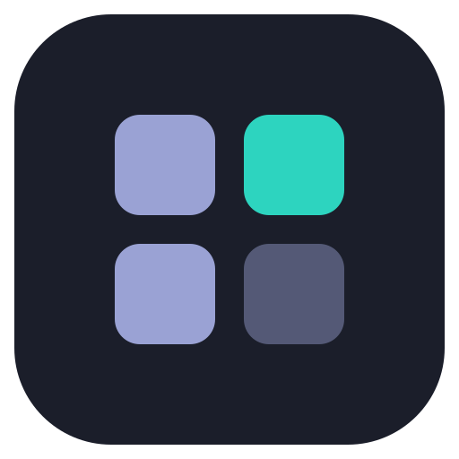
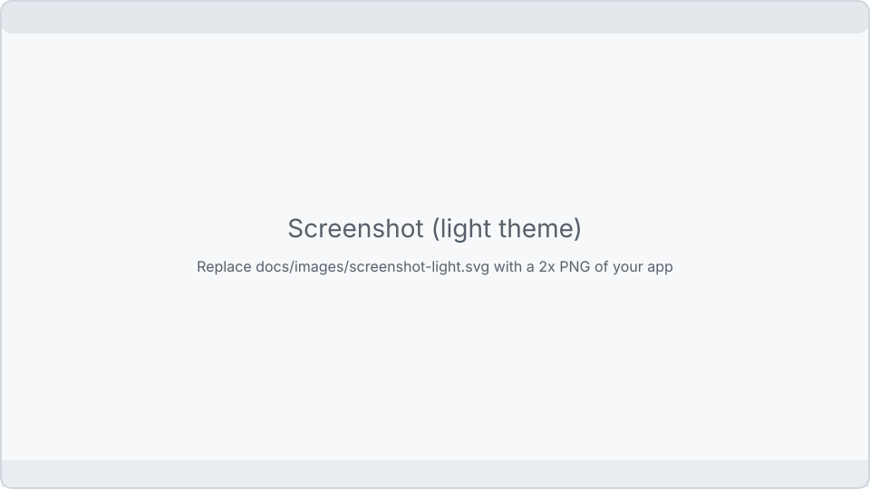

<p align="center">
  
</p>

<h1 align="center">ExampleApp</h1>

<p align="center">

[](https://github.com/adriandeleon/ExampleApp/actions/workflows/ci.yml)
[](https://github.com/adriandeleon/ExampleApp/releases/latest)
[](LICENSE)


[](https://github.com/adriandeleon/adl-desktop-apps-guidelines/blob/v1.1.0/CHANGELOG.md)
[](https://github.com/adriandeleon/ExampleApp/stargazers)

</p>

<!-- template:start -->
> [!IMPORTANT]
> **This is the template for [Pauta (the adl desktop apps guidelines)](https://pauta-project.dev/), edition [1.1.0](https://github.com/adriandeleon/adl-desktop-apps-guidelines/blob/v1.1.0/CHANGELOG.md).** Click **Use this template**, clone your new repository, then run:
>
> ```bash
> scripts/rename.sh MyApp com.myapp
> ./mvnw verify
> ./mvnw javafx:run
> ```
>
> `rename.sh` turns every `ExampleApp` / `exampleapp` / `EXAMPLEAPP` / `com.example.app` into your
> names, moves the package folders, gives the Windows installer its own upgrade code, and deletes
> this box, the rename check in CI and itself. Then replace the icon (`branding/`, then
> `scripts/make-icons.sh`) and the screenshots, and write your app in `MainWindow`'s placeholder.
> Everything Pauta 1.1.0 marks MUST is already here and tested: see
> [docs/architecture.md](docs/architecture.md) for where each piece lives.
<!-- template:end -->

ExampleApp is a keyboard-first JavaFX desktop app for Windows, macOS and Linux. Every action is a
command you can run from the Command Palette, and nothing leaves your computer unless you ask.

Built to [Pauta (the adl desktop apps guidelines)](https://pauta-project.dev/), edition [1.1.0](https://github.com/adriandeleon/adl-desktop-apps-guidelines/blob/v1.1.0/CHANGELOG.md).

<p align="center">
  <picture>
    <source media="(prefers-color-scheme: dark)" srcset="docs/images/screenshot-dark.svg">
    
  </picture>
</p>

## Highlights

- **Keyboard first.** A Command Palette (`Ctrl/Cmd+Shift+P`, or `M-x` in the Emacs keymap) finds and
  runs every command. CUA and Emacs keymaps, with your own bindings on top.
- **Settings that apply as you change them.** A searchable Settings window, a palette command for
  every setting, and a versioned config folder that older versions never overwrite.
- **Light and dark**, following your system, with the Inter typeface on every OS.
- **Settings Sync** through a private Git repository you own.
- **Nothing fails silently.** A Message Log of every status message, a Debug Log of everything
  logged, and Help → Report a Problem to open a redacted, prefilled GitHub issue.
- **Six languages:** English, Spanish, Portuguese, French, Italian and German.
- **Local first.** No telemetry. The only automatic network call is a once-a-day release check you
  can turn off.

## Install

Download the installer for your system from the
[latest release](https://github.com/adriandeleon/ExampleApp/releases/latest):

| System | Download |
|---|---|
| macOS (Apple Silicon / Intel) | `ExampleApp-<version>-macos-arm64.dmg` / `-macos-x64.dmg`, signed and notarized |
| Windows x64 | `ExampleApp-<version>-windows-x64.msi` |
| Linux x64 / arm64 | `.deb`, `.rpm`, `.AppImage` or `.tar.gz`, each with an `.asc` signature |

Every download has a build provenance attestation:
`gh attestation verify <file> --repo adriandeleon/ExampleApp`.

## Build

You need JDK 25 or newer. The Maven Wrapper fetches Maven.

```bash
./mvnw javafx:run                 # run the app
./mvnw test                       # unit + headless FX tests, writes the JaCoCo report
./mvnw spotless:apply             # format
./mvnw verify                     # full gate: tests, coverage check, NullAway, formatting
./mvnw -Pfatjar package           # runnable fat jar for this OS
./mvnw clean -Pdist package       # native app image for this OS (clean is mandatory)
```

[CONTRIBUTING.md](CONTRIBUTING.md) has the rest, and [docs/](docs/) explains how the app is built.

## Command line

```text
exampleapp [options] [files...]

  -h, --help            Show the help and exit
  -v, --version         Show the version and exit
      --config-dir DIR  Use DIR as the config folder (default ~/.exampleapp)
      --dev             Use ~/.exampleapp-dev, so a development build keeps its own config
      --new-instance    Start a second process instead of handing off to the running one
      --no-session      Do not restore the last window size and position
      --report          Write a redacted problem report and open a GitHub issue
```

A second launch on the same config folder hands its arguments to the running app and exits.

## Config folder

Settings live in `~/.exampleapp` (`~/.exampleapp-dev` with `--dev`, or `EXAMPLEAPP_CONFIG_DIR`):

| File | What |
|---|---|
| `settings.json` | Preferences, with a `schemaVersion`; migrated forward on upgrade, backed up when a newer version wrote it |
| `exampleapp-session.log` | This session's Debug Log; the previous one is `exampleapp-session.prev.log` |
| `sync/` | The Settings Sync clone, when sync is set up |

Settings → Advanced exports the folder as a `.zip` and imports one back.

## Licence

ExampleApp is released under the [MIT License](LICENSE). Third-party components and their licences
are listed in [NOTICE](NOTICE). ExampleApp is built with the help of AI coding tools.
